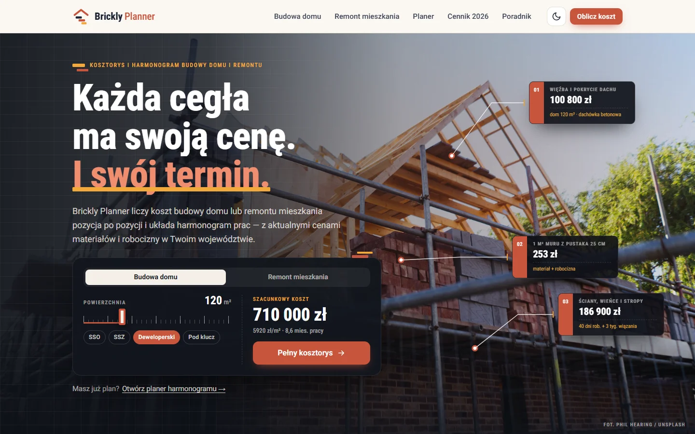
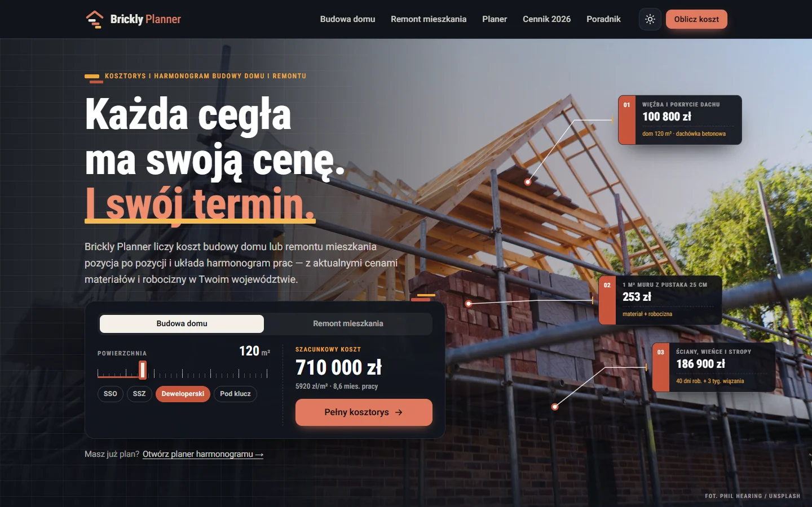
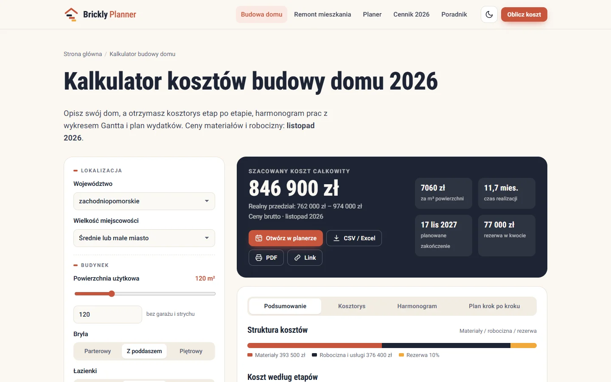
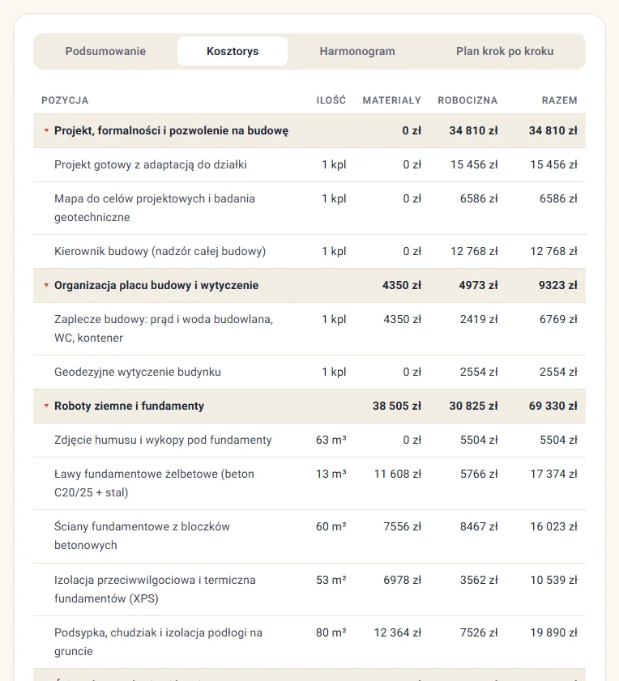
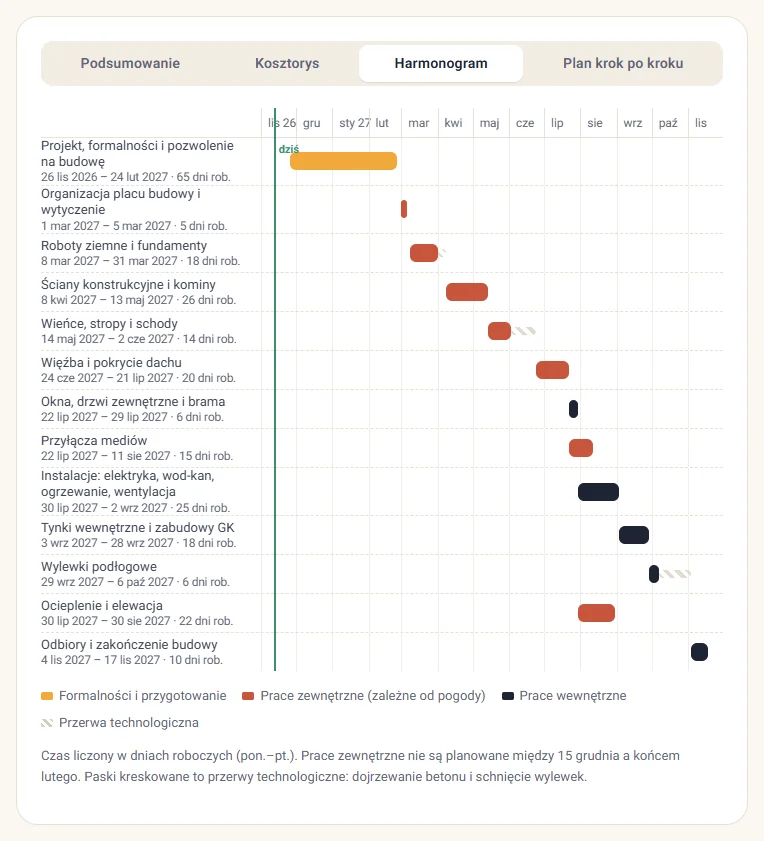
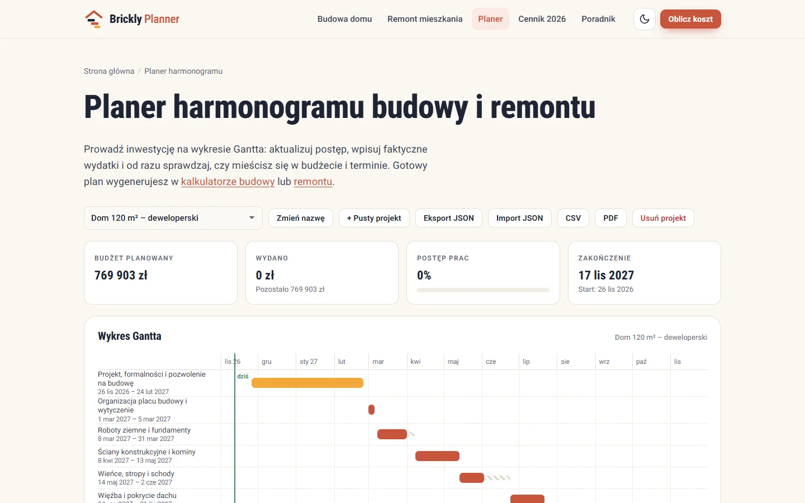
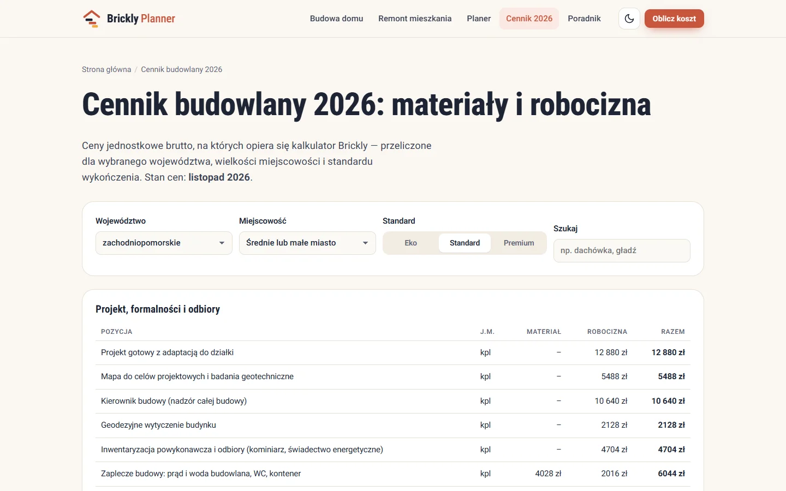

# Brickly Planner

A web app for planning and scheduling house construction and apartment renovation in Poland.
From a few inputs it builds an **itemised cost estimate**, a **work schedule (Gantt chart)** and a **month-by-month spending plan**,
based on current Polish prices for materials and labour (price level: November 2026).

The user interface and content are in Polish, since the app targets the Polish market.

**Live:** https://goldipl.github.io/brickly-planner/

## Screenshots

<table>
  <tr>
    <td width="50%"></td>
    <td width="50%"></td>
  </tr>
  <tr>
    <td align="center"><b>Home page</b><br><sub>Hero with annotated stage costs and a quick estimate by floor area and scope</sub></td>
    <td align="center"><b>Dark mode</b><br><sub>Light and dark themes, toggled from the header and remembered between visits</sub></td>
  </tr>
  <tr>
    <td></td>
    <td></td>
  </tr>
  <tr>
    <td align="center"><b>House construction calculator</b><br><sub>Total cost, realistic range, cost per m², duration and completion date</sub></td>
    <td align="center"><b>Apartment renovation calculator</b><br><sub>Room count, bathrooms and work scope, priced for the selected region</sub></td>
  </tr>
  <tr>
    <td></td>
    <td></td>
  </tr>
  <tr>
    <td align="center"><b>Itemised cost estimate</b><br><sub>Quantities, materials and labour for every item, grouped by stage</sub></td>
    <td align="center"><b>Work schedule</b><br><sub>Gantt chart in working days, with technological breaks and a winter break</sub></td>
  </tr>
  <tr>
    <td></td>
    <td></td>
  </tr>
  <tr>
    <td align="center"><b>Planner</b><br><sub>Track budget, actual spending and progress; export to JSON, CSV or PDF</sub></td>
    <td align="center"><b>Price list 2026</b><br><sub>Unit prices for materials and labour, filtered by region and finish standard</sub></td>
  </tr>
</table>

## Features

- **House construction calculator**: scope from shell (SSO) to turnkey, building shape, wall technology, foundations, roof, heating, heat recovery ventilation, PV, utility connections and permits, prices for all 16 Polish voivodeships.
- **Apartment renovation calculator**: 4 preset scopes and 18 work types; block of flats, tenement or new build.
- **Schedule** in working days with stage dependencies, technological breaks (concrete curing, screed drying), a winter break for outdoor work, and lead times for windows and kitchens.
- **Planner**: projects stored in localStorage, editable tasks, automatic shifting of dependent tasks, planned vs actual budget, progress tracking, JSON import/export, CSV (Excel) export and print to PDF.
- **Price list 2026**: unit prices recalculated for region and finish standard.
- **Light and dark theme**: follows the system setting by default, with a manual toggle remembered in localStorage.
- **SEO**: static HTML, meta and Open Graph tags, canonical URLs, sitemap.xml, robots.txt, structured data (Organization, WebSite, WebApplication, Article, BreadcrumbList, FAQPage) and guide articles.

## Tech stack

Next.js 16 (App Router, static export) · React 19 · TypeScript · SCSS (Sass modules with `@use`, token maps and mixins) · Roboto and Roboto Condensed via `next/font`

## Getting started

```bash
npm install
npm run dev        # http://localhost:3000
npm run build      # static site in out/
npm run preview    # serve out/ locally
npm test           # cost engine tests (node --test)
npm run typecheck
```

## Project structure

```
app/                 pages (App Router), sitemap, robots, manifest
components/          UI: header, footer, SEO/JSON-LD, Gantt chart
  calculator/        calculator forms and results panel
  home/              home page hero, quick estimate, price ticker, animations
  planner/           schedule planner
lib/
  data.ts            price database (materials + labour), regions, standards
  engine.ts          engine: building geometry, stages, pricing, scheduling
  dates.ts           working days, winter break
  export.ts          CSV export and estimate-to-project conversion
  site.ts            site URL, base path, navigation, SEO metadata
styles/              SCSS partials: _tokens, _mixins, _base, _layout, _components,
                     _calculator, _gantt, _planner, _home, _print
design/icons/        SVG sources for the favicon and app icons
docs/screenshots/    README screenshots
scripts/             icon generator, static export post-processing
public/              logos, hero photo, OG image, generated icons
```

## Updating prices

Base prices live in `lib/data.ts` (`PRICES`). To shift the whole price list to the current market level,
change `INDEX.mat` and `INDEX.lab`, then update `PRICE_DATE` and `PRICE_LABEL`.
`npm test` checks that the cost per m² stays within market ranges.

## Favicon and app icons

Sources are in `design/icons/`:

- `favicon-16.svg` and `favicon-32.svg` are simplified, pixel-grid-aligned versions,
- `icon.svg` is the rounded square (SVG favicon and PWA icon),
- `app-icon.svg` is a full-bleed square without transparency (iOS and Android maskable).

After editing any of them run `npm run icons`. It generates in `public/`: `favicon.ico` (16/32/48),
`icon.svg`, iOS icons 120/152/167/180 px (+ `apple-touch-icon.png`) and Android icons 192/512 px in `any` and `maskable` variants.

## Deployment

### GitHub Pages

Every push to `main` runs `.github/workflows/nextjs.yml`: it installs dependencies, runs the tests, builds the static site
and publishes `out/` to GitHub Pages. The site is served from a subpath (`/brickly-planner`), so the workflow sets:

- `NEXT_PUBLIC_BASE_PATH` – the subpath, used for `basePath` and for plain asset URLs (`asset()` in `lib/site.ts`),
- `NEXT_PUBLIC_SITE_URL` – the full site URL, used for canonical links, Open Graph, the sitemap and robots.txt.

Both values come from `actions/configure-pages`, so nothing is hard-coded. In the repository settings,
**Settings → Pages → Source** must be set to **GitHub Actions**.

### Other hosting

Without these variables the build targets the root of a custom domain (`https://brickly-planner.pl` by default, see `lib/site.ts`).
The `out/` folder can be uploaded to any static host (Vercel, Netlify, Cloudflare Pages).

## Credits

Hero photo by [Phil Hearing](https://unsplash.com/photos/house-construction-with-scaffolding-and-brickwork-6lvui3Ak-eA) on Unsplash (Unsplash License).
